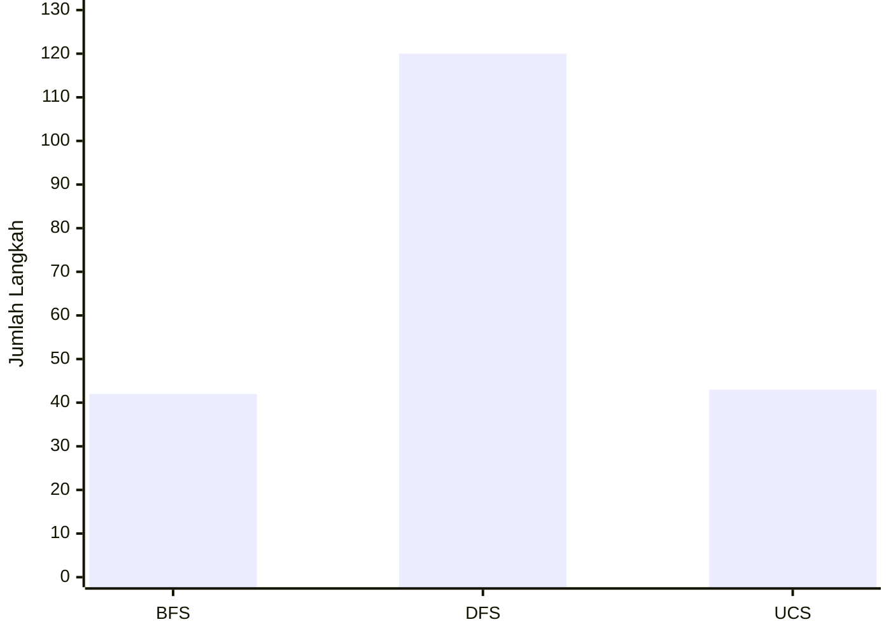
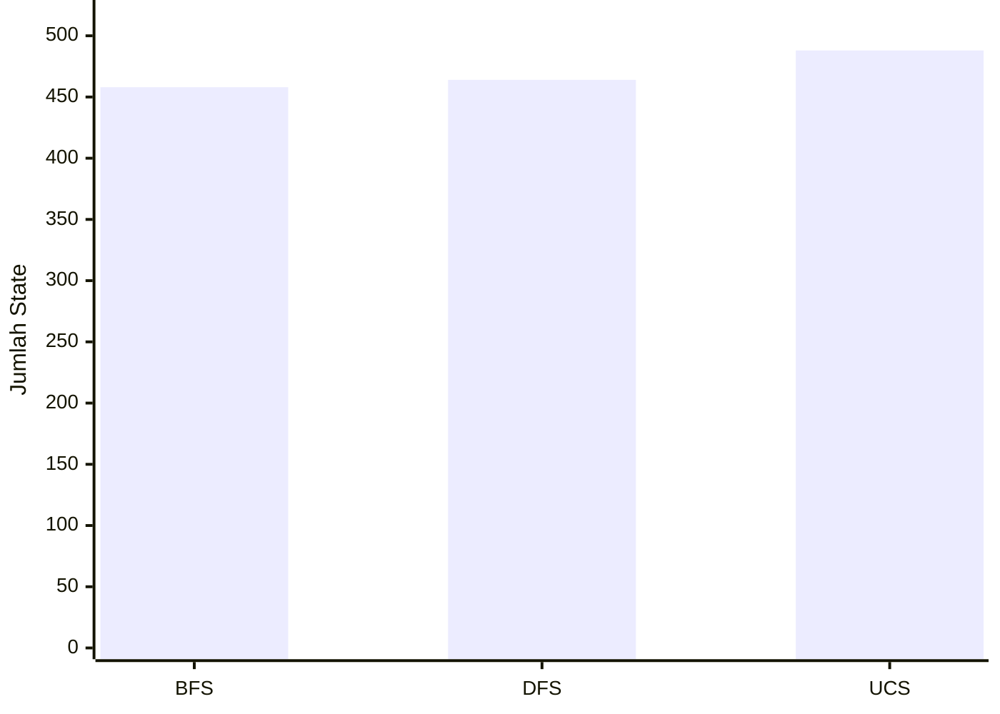
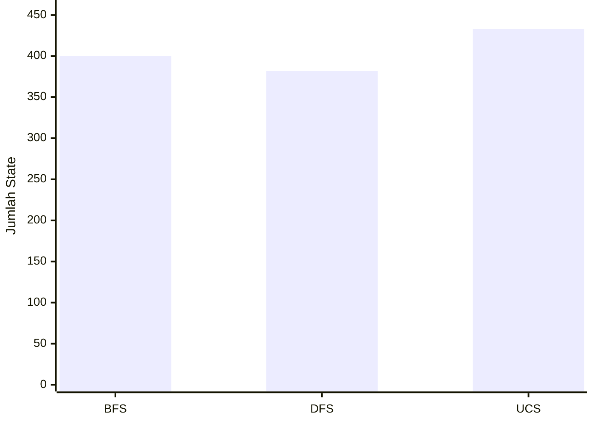
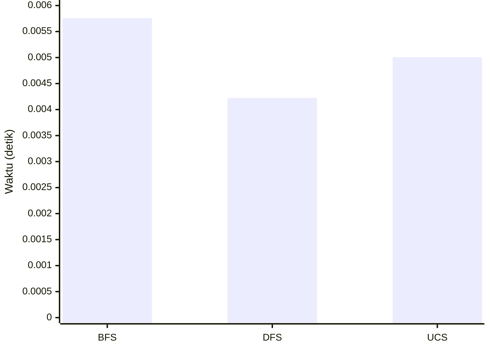

## Anggota Kelompok

| No           | Name        | NRP     |
| ---            | ---        | ----------|
| 1 | Luthfir Rizqy Fathullah Hanggi | 5025251081 |
| 2 | Yesenia Valencia W| 5025251182 | 
| 3 | Claresta Amelinda H. | 5025251184 | 
| 4 | Jessica Febiola| 5025251216 | 
| 5 | I Made Bagus Naratama | 5025251233 | 

# Roll to Vivat

Roll to Vivat adalah game puzzle berbasis Python dan Pygame yang terinspirasi dari permainan Bloxorz. Pemain menggerakkan sebuah balok di atas papan untuk mencapai kotak tujuan tanpa terjatuh dari jalur. Game ini menyediakan tiga level dengan tantangan yang berbeda serta fitur Solver untuk mencari urutan gerakan secara otomatis.

# Roll to Vivat DEMO
[DEMO](https://youtu.be/-NOatepVtec)

## Fitur

- **3 level permainan** dengan susunan papan dan tantangan yang berbeda.
- **Kontrol manual** menggunakan tombol panah pada keyboard.
- **Mekanisme jembatan di Level 2** yang melibatkan switch O dan X.
- **Solver otomatis** menggunakan tiga algoritma pencarian:
  - **BFS (Breadth-First Search):** menelusuri kemungkinan gerakan berdasarkan urutan tingkat kedalaman.
  - **DFS (Depth-First Search):** menelusuri satu jalur lebih dalam sebelum mencoba jalur lain.
  - **UCS (Uniform-Cost Search):** memilih state berdasarkan total biaya gerakan.
- **Solver Performance** untuk menampilkan jumlah state yang ditemukan, jumlah state yang diperiksa, dan waktu pencarian.
- **Musik latar dan efek suara** untuk halaman permainan, halaman party, serta jumpscare.
- **Tampilan yang dapat menyesuaikan ukuran jendela** tanpa mengubah proporsi desain permainan.

## Teknologi

- Python
- Pygame

## Struktur Proyek

```text
KKA-mini-project-kel8/
├── assets/
│   ├── bgsound/
│   └── ... (gambar dan aset permainan lainnya)
├── vivatfortc/
│   ├── dfs_vivatfortc.py
│   └── testmap_vivatfortc.py
├── fireworks.py
├── game_logic.py
├── game_render.py
├── main.py
└── solver.py
```

### Fungsi File Utama

| File | Keterangan |
|---|---|
| `main.py` | Menjalankan game, mengatur navigasi halaman, input pemain, sound, dan proses Solver. |
| `game_logic.py` | Mengatur pergerakan balok, pengecekan balok jatuh atau mencapai tujuan, serta aktivasi jembatan. |
| `game_render.py` | Mengatur data level, pemuatan aset, layout, dan tampilan setiap halaman permainan. |
| `solver.py` | Berisi implementasi algoritma BFS, DFS, dan UCS. |
| `fireworks.py` | Mengatur efek kembang api pada bagian akhir permainan. |
| `assets/` | Menyimpan gambar, background, dan musik yang digunakan dalam game. |
| `vivatfortc/` | Menyimpan file Python pendukung yang terdapat dalam proyek. |

## Persiapan dan Instalasi

Pastikan Python sudah terpasang di komputer.

1. Clone repository:

   ```bash
   git clone <URL-REPOSITORY>
   ```

2. Masuk ke folder proyek:

   ```bash
   cd KKA-mini-project-kel8
   ```

3. Install Pygame:

   ```bash
   pip install pygame
   ```

## Cara Menjalankan Game

Jalankan perintah berikut dari folder utama proyek:

```bash
python main.py
```

Pastikan folder `assets/` tetap berada di dalam folder proyek agar gambar dan musik dapat dimuat dengan benar.

## Kontrol Permainan

| Tombol / Input | Fungsi |
|---|---|
| `↑` | Menggerakkan balok ke atas |
| `↓` | Menggerakkan balok ke bawah |
| `←` | Menggerakkan balok ke kiri |
| `→` | Menggerakkan balok ke kanan |
| `R` | Mengulang level yang sedang dimainkan |
| `ESC` | Kembali ke halaman sebelumnya atau menu pemilihan level |
| `ENTER` | Melanjutkan dari halaman kemenangan |
| Klik **BFS / DFS / UCS** | Memilih algoritma Solver |
| Klik **Solve** | Menjalankan Solver yang dipilih |

## Cara Menggunakan Solver

1. Masuk ke salah satu level.
2. Pilih algoritma **BFS**, **DFS**, atau **UCS** pada bagian Solver.
3. Klik tombol **Solve**.
4. Solver akan mencari urutan gerakan menuju kotak tujuan.
5. Jika solusi ditemukan, balok akan bergerak otomatis mengikuti hasil pencarian.
6. Setelah proses selesai, informasi performa Solver akan ditampilkan.

## Catatan

- Setiap gerakan pemain maupun Solver mengikuti aturan posisi balok pada permainan Bloxorz.
- Balok harus tetap berada di atas tile yang tersedia. Jika keluar dari jalur, permainan akan masuk ke halaman jumpscare.
- Level 2 memiliki mekanisme switch untuk mengaktifkan jembatan.
- Untuk menjalankan game, gunakan folder proyek secara utuh dan jangan memisahkan file Python dari folder `assets/`.

## 📸 Dokumentasi
### 1. Landing Page


*Tampilan awal Roll to Vivat dengan tombol Start.*

### 2. Pemilihan Level


*Tampilan pemilihan tiga stage dengan sistem unlock.*

### 3. Gameplay Level 1


*Pemain mengarahkan balok menuju petak tujuan.*

### 4. Gameplay Level 2


*Tantangan tombol O dan X untuk membuka jembatan.*

### 5. Gameplay Level 3


*Tantangan lintasan pada level terakhir.*

### 6. Solver dan Statistik


*Pilihan Algoritma solver dan statistik hasil pencarian.*

### 7. Ending / Party


*Tampilan akhir setelah pemain menyelesaikan permainan.*


## Perbandingan Hasil Pengujian

Pengujian dilakukan pada tiga level menggunakan algoritma BFS, DFS, dan UCS. Berikut perbandingan hasil dari masing-masing algoritma berdasarkan empat indikator.

### 1. Path Length

Jumlah langkah yang dibutuhkan balok untuk mencapai tujuan. Semakin sedikit jumlah langkah, semakin pendek jalur yang ditemukan.



**Terbaik: BFS** — menghasilkan jalur dengan jumlah langkah paling sedikit.

### 2. Discovered State

Jumlah state yang ditemukan selama proses pencarian.



**Terbaik: BFS** — menemukan jumlah state paling sedikit.

### 3. Expanded State

Jumlah state yang dikembangkan untuk mencari kemungkinan gerakan berikutnya.



**Terbaik: DFS** — memiliki jumlah expanded state paling sedikit.

### 4. Execution Time

Waktu yang dibutuhkan algoritma untuk menemukan solusi. Semakin kecil waktunya, semakin cepat proses pencarian.



**Terbaik: DFS** — memiliki waktu pencarian paling singkat.

### Kesimpulan Perbandingan Algoritma Uninformed Search (BFS, DFS, UCS)

Berdasarkan hasil pengujian, BFS lebih unggul dalam menghasilkan jalur yang pendek dan menemukan jumlah state yang lebih sedikit. Sementara itu, DFS memiliki waktu pencarian paling singkat dan jumlah expanded state paling sedikit, meskipun jalur yang dihasilkan lebih panjang. UCS memberikan hasil jalur yang hampir sama dengan BFS karena setiap gerakan memiliki biaya yang sama. Dengan demikian, setiap algoritma memiliki keunggulan masing-masing berdasarkan aspek yang dibandingkan.

## Daftar Pustaka

Clarke, D. (1999). Bloxorg [Video Game].https://www.coolmathgames.com/0-bloxorz?variant=next
Iyer. S. (2012). Bloxorg. Github. https://github.com/supersaiyanmode/Bloxorz
